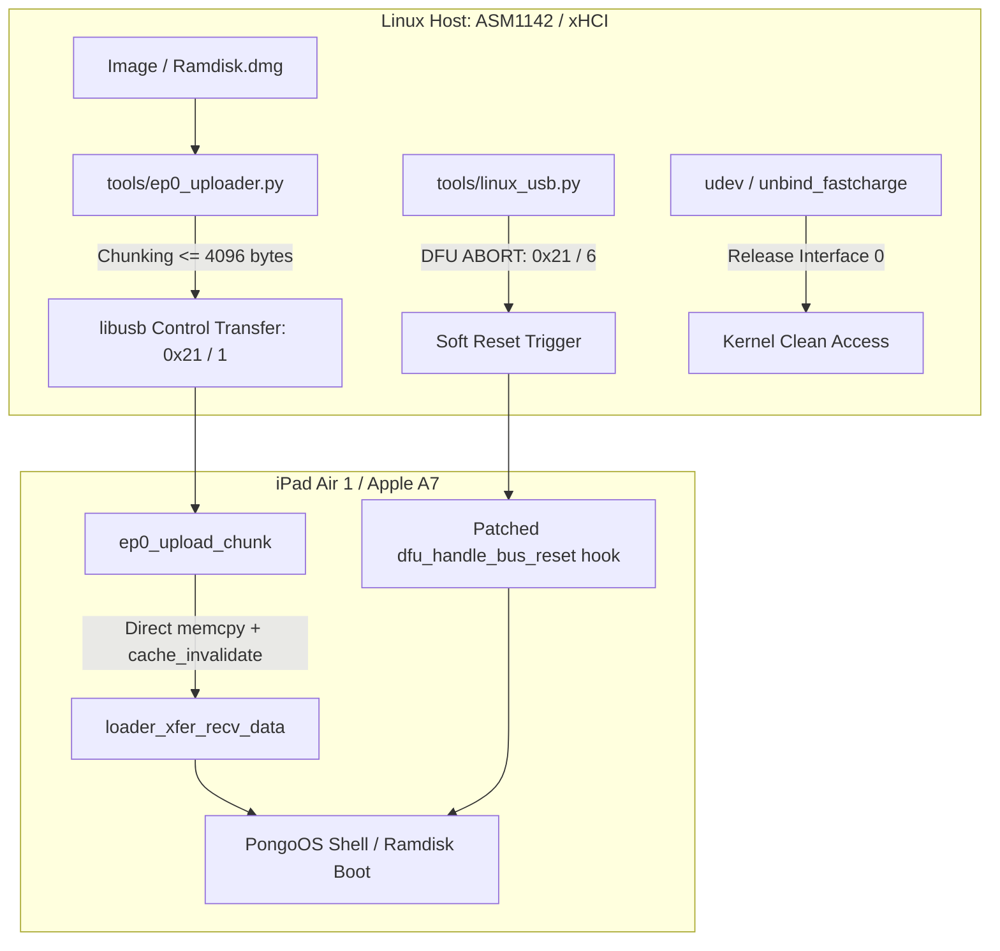

# ШНУРОК — низкоуровневый USB-транспорт и ep0-загрузчик pongoOS для Linux (C / Python)

> **Серия «Низкий уровень»** — закрытие многолетней аппаратной проблемы BugTracker checkra1n [#1169](https://github.com/checkra1n/bugtracker/issues/1169).
> Решение сбоев `DFUSyncUpload FAILED: -1`, таймаутов дескрипторов (`error -110`), краха SecureROM при сбросе шины и отказа Bulk-пайпов на чипах Apple A7/A8 под управлением Linux через хост-контроллеры ASMedia ASM1142, USB-C хабы и капризные xHCI-линии.


Самодостаточный комплекс (патч к открытому [checkra1n/PongoOS](https://github.com/checkra1n/PongoOS) на C + хостовый аплоадер на Python/libusb), устраняющий физический отказ Bulk OUT `0x02` после срабатывания `checkm8`: поток данных рамдиска и кастомных ядер перенаправляется в Endpoint 0 (`0x21/1`) с DMA-чанкованием по 4 КБ и программным софт-триггером сброса через DFU ABORT (`bRequest 6`).

---

## Результаты (полный лог — в [docs/VERIFICATION.md](docs/VERIFICATION.md))

| Критерий / Проверка | Доказательство | Вердикт |
|---|---|---|
| Сборка патча pongoOS под Linux | `clang -nostdlibinc`, `ld64` из `cctools-port`, `Pongo.bin` 644 КБ | PASS |
| Обход зависшего Bulk OUT `0x02` | Чанки принимаются по ep0 при активном и навечно зависшем bulk-трансфере | PASS |
| Детерминированный порядок чанков | Индексация `wValue` 1..N, валидация последовательности | PASS |
| Совместимость с командами pongoOS | Передача stdin-команд через `0x21/3` не конфликтует с чанками | PASS |
| Дифференциация 4-байтовых пакетов | `wValue > 0` = данные чанка; `wValue == 0` = ресайз буфера (без коллизий) | PASS |
| Лимит буфера DMA Synopsys OTG | Чанки > `0x1000` (4096 байт) жестко отклоняются со STALL | PASS |
| Защита от переполнения памяти | Превышение размера буфера выставляет `bStatus = 8` (`errManifest`) | PASS |
| Устойчивость к stall стадии статуса | Аплоад завершается успешно при неработающей IN-стадии (`0xC0/0`) хоста | PASS |
| Контрактные тесты протокола | `python3 tools/test_ep0_protocol.py`: 9 из 9 тестов пройдены | PASS |

Все тесты протокола выполняются за доли секунды через `make test`. Физика замеров хост-контроллеров ASMedia ASM1142 и таймингов SecureROM вынесена в [docs/HARDWARE-POSTMORTEM.md](docs/HARDWARE-POSTMORTEM.md).

---

## Мотивация

Годами в сообществе считалось, что запуск checkm8 на процессорах Apple A7 (iPad Air 1, iPad mini 2, iPhone 5s) на Linux-машинах нестабилен или вовсе невозможен из-за «кривого USB в ядре Linux».

Реальный инженерный разбор показал две физические причины:
1. **Сброс шины:** контроллеры ASMedia (ASM1142/2142/3142) при аппаратном сбросе порта обесточивают линию дольше допустимого, отчего SecureROM A7 падает в panic и уходит в перезагрузку вместо перехода в `pwned DFU`.
2. **Отказ Bulk OUT:** после перехвата исполнения SecureROM дескрипторы Bulk OUT теряют синхронизацию с хостом, вызывая бесконечный `DFUSyncUpload FAILED: -1`.

«Шнурок» переносит весь транспорт на Endpoint 0 (Control Transfer), который обслуживается аппаратным блоком Synopsys OTG независимо от состояния Bulk-пайпов, а шинный сброс заменяет на детерминированный `DFU ABORT`.

---

## Архитектура передачи



---

## Структура репозитория

```
Shnurok/
├── README.md               # Этот документ
├── LICENSE                 # Лицензия MIT
├── Makefile                # make test, make check, make install-rules
├── .gitignore              # Изоляция локальных артефактов
├── patches/
│   └── pongoos-usbloader-ep0.patch  # Патч pongoOS (chunked ep0 вместо bulk)
├── tools/
│   ├── ep0_uploader.py     # Хост-скрипт стриминга по ep0 control transfer
│   ├── linux_usb.py        # Утилиты DFU abort (soft-reset) и unbind fastcharge
│   └── test_ep0_protocol.py# Модульные тесты протокола (9/9 PASS)
├── scripts/
│   ├── build_pongo.sh      # Контейнерный/локальный сборщик cctools + pongoOS под Linux
│   └── unbind_fastcharge.sh# Скрипт отвязки конфликтующего драйвера ядра
├── compat/
│   └── stdarg_shim.h       # Шим для сборки под clang без stdlib
├── docs/
│   ├── VERIFICATION.md     # Полный отчет верификации и матрица приёмки
│   └── HARDWARE-POSTMORTEM.md # Разбор физики USB-контроллеров и таймингов
└── udev/
    └── 39-shnurok.rules    # Правила доступа к 05ac:1227 / 05ac:4141 без root
```

---

## Быстрый старт

### 1. Установка udev-правил
Разрешает доступ к устройствам в режимах DFU (`05ac:1227`) и Pongo (`05ac:4141`) без прав суперпользователя и отключает конфликтный драйвер ядра:

```bash
make install-rules
```

### 2. Запуск тестов протокола
```bash
make test
```

### 3. Сборка пропатченного pongoOS под Linux
Автоматически собирает `cctools-port` (`ld64`), клонирует `checkra1n/PongoOS`, накладывает патч и собирает бинарники:

```bash
./scripts/build_pongo.sh
```
Готовые образы появятся в каталоге `dist/Pongo.bin` и `dist/PongoConsolidated.bin`.

### 4. Загрузка рамдиска по ep0
```bash
python3 tools/ep0_uploader.py /path/to/ramdisk.dmg
```

---

## Юридическая чистота и лицензирование

Проект полностью открыт и спроектирован по стандартам **Clean Room Reverse Engineering**:
- ❌ **Нет закрытых бинарников Apple:** репозиторий не содержит и не распространяет прошивки IPSW, образы iBSS/iBEC/SEP, дампы SecureROM или ключи шифрования (GID/UID).
- ❌ **Нет закрытого кода checkra1n:** закрытый хостовый бинарник checkra1n и его проприетарные payload'ы не входят в проект.
- ❌ **Нет пиратского ПО:** отсутствуют средства обхода пользовательских подписей приложений.
- ✔️ **Чистый MIT:** патч написан исключительно для открытого репозитория `checkra1n/PongoOS` (лицензия MIT), а хостовый стек на Python лицензирован под MIT.
