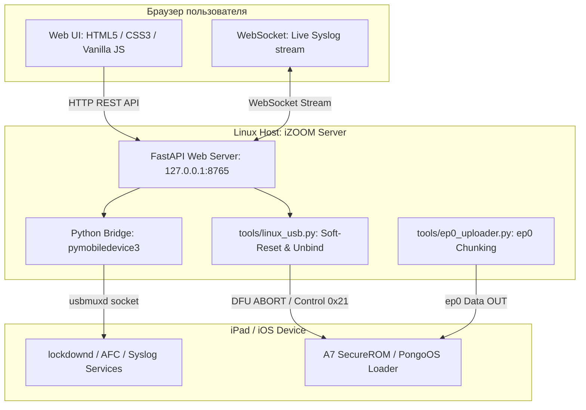

# ШНУРОК (iZOOM) — станция управления, файловый менеджер и реанимация iPad под Linux

> **Полноценная локальная веб-консоль для работы с iOS-устройствами на Linux + низкоуровневый USB-транспорт.**  
> Предоставляет графический интерфейс управления айпадом (паспорт, батарея, файловый менеджер AFC, установка IPA, стриминг syslog, очистка кэшей) и закрывает многолетний аппаратный сбой checkra1n [#1169](https://github.com/checkra1n/bugtracker/issues/1169) (`DFUSyncUpload FAILED: -1`) на чипах Apple A7/A8 при подключении через капризные xHCI, ASMedia ASM1142 и USB-C хабы.


---

## 🖥️ Графический интерфейс (Веб-консоль iZOOM)

Станция запускается локально в один клик (`./run.sh`) и открывает панель управления устройством в браузере (`http://127.0.0.1:8765`):

```text
┌─ iZOOM ────────────────────────────────────────────────────────────────────────┐
│ [● USB: подключен]  iPad Air (Wi-Fi) · iOS 12.5.7 · 16H81                      │
├──────────────┬─────────────────────────────────────────────────────────────────┤
│  Разделы:    │  [ Паспорт устройства ]                                         │
│              │  • Серийный номер:  DMTLR2XN****    • Батарея:     94% (Здорова)│
│  ► Обзор     │  • UDID:            0679267e0d6a... • Память:      5.2 ГБ своб. │
│  • Файлы     │  • Процессор:       Apple A7 (J71AP)• Экран/Обои:  [Снимок экрана]│
│  • Программы ├─────────────────────────────────────────────────────────────────┤
│  • Журнал    │  [ Менеджер файлов (AFC) ]                                      │
│  • Копии     │  Область: [ Media ▼ ]  Путь: /DCIM/100APPLE/                    │
│  • Скорость  │  [Загрузить файл]  [Создать папку]  [Скачать выбранное]         │
│  • Система   ├─────────────────────────────────────────────────────────────────┤
│              │  [ Тюнинг скорости и очистка ]                                  │
│              │  • Очистка кэшей приложений (Caches / tmp)                      │
│              │  • Сброс системных отчетов об ошибках (CrashReporter)           │
│              │  • Профиль облегчения: отключение размытия и анимаций           │
└──────────────┴─────────────────────────────────────────────────────────────────┘
```

### 📌 7 ключевых разделов станции

| Раздел | Возможности и функционал |
| :--- | :--- |
| **1. Паспорт (Overview)** | Диагностика аккумулятора (процент, циклы, статус ячейки), остаток памяти хранилища, системные идентификаторы (UDID, ECID, модель платы), снятие скриншотов экрана в реальном времени и выгрузка обоев рабочего стола. |
| **2. Файлы (Files)** | Полноценный файловый менеджер через Apple File Conduit (AFC): навигация по медиа-хранилищу, песочницам приложений (`AppDocs`, `AppBox`), краш-логам и корню (`root`, при наличии джейлбрейка). Скачивание, пакетная загрузка, создание папок, переименование. |
| **3. Программы (Apps)** | Список пользовательских и системных приложений с иконками, учет занимаемого места, безопасное удаление и установка `.ipa` пакетов без iTunes. |
| **4. Журнал (Syslog)** | Потоковый просмотр системного лога iOS (syslog) через WebSocket в реальном времени с фильтрацией по процессам и поиском аномалий. |
| **5. Копии (Backups)** | Создание локальных резервных копий устройства на диск Linux-машины и восстановление данных без облака Apple. |
| **6. Скорость (Speed)** | Очистка диска от мусора (удаление временных кэшей программ, дампов падений), выявление самых «тяжелых» приложений и применение профиля легкости (отключение тяжелых эффектов интерфейса). |
| **7. Система (System)** | Управление питанием (сон, мягкая перезагрузка, выключение по шине), смена имени и локали устройства, управление профилями конфигурации, встроенный модуль низкоуровневого перевода в Recovery/DFU. |

---

## 🔬 Низкоуровневый драйвер: закрытие бага ASM1142 / A7 (checkm8)

Помимо высокоуровневого управления через `pymobiledevice3`, проект содержит аппаратный фикс для старых устройств на процессорах Apple A7/A8 (iPad Air 1, iPad mini 2, iPhone 5s):

1. **Транспорт через Endpoint 0 (`pongoos-usbloader-ep0.patch`):**
   После срабатывания checkm8 на Linux-хостах с внешними xHCI-контроллерами (ASMedia ASM1142, USB-C док-станции) стандартный Bulk OUT `0x02` загрузчика pongoOS аппаратно зависает (`DFUSyncUpload FAILED: -1`). Патч «Шнурка» перенаправляет поток рамдиска в Endpoint 0 (`0x21/1`) чанками по 4 КБ со сбросом кэша DMA.
2. **Soft-Reset через DFU ABORT:**
   Контроллеры ASM1142 при вызове `libusb_reset_device()` обесточивают порт дольше допустимого, отчего A7 SecureROM падает в panic и уходит в reboot. Проект заменяет аппаратный сброс на программный запрос `DFU_ABORT` (`bRequest 6`), позволяя SecureROM детерминированно перезапустить цикл энумерации.
3. **Автоматический Unbind ядра:**
   Модуль ядра `apple-mfi-fastcharge` блокирует интерфейс устройства; проект автоматически отвязывает его через udev-правила.

---

## 🏗️ Архитектура комплекса



---

## 📂 Структура репозитория

```
Shnurok/
├── README.md               # Документация и руководство
├── LICENSE                 # Лицензия MIT
├── Makefile                # make run, make test, make install-rules
├── requirements.txt        # Зависимости Python (FastAPI, uvicorn, pymobiledevice3)
├── run.sh                  # Скрипт запуска веб-станции в 1 клик
├── console/                # Серверная часть и веб-интерфейс iZOOM
│   ├── server.py           # FastAPI роутер, эндпоинты API и WebSocket
│   ├── bridge.py           # Асинхронный мост к службам iOS (AFC, lockdownd)
│   └── static/             # Фронтенд (HTML, CSS, JS, SVG)
├── patches/
│   └── pongoos-usbloader-ep0.patch  # Патч загрузчика pongoOS под ep0
├── tools/
│   ├── ep0_uploader.py     # Хост-скрипт стриминга образов через ep0
│   ├── linux_usb.py        # Утилиты soft-reset и unbind ядра
│   └── test_ep0_protocol.py# Модульные тесты протокола ep0 (9/9 PASS)
├── scripts/
│   ├── build_pongo.sh      # Контейнерный/локальный сборщик cctools + pongoOS
│   └── unbind_fastcharge.sh# Отвязка конфликтного драйвера ядра
├── compat/
│   └── stdarg_shim.h       # Шим для clang без stdlib
├── docs/
│   ├── VERIFICATION.md     # Полный отчет верификации и матрица тестов
│   └── HARDWARE-POSTMORTEM.md # Разбор физики шины ASM1142 и таймингов SecureROM
└── udev/
    └── 39-shnurok.rules    # Правила доступа к DFU/Pongo без root
```

---

## 🚀 Быстрый старт

### 1. Установка зависимостей и правил udev
```bash
pip install -r requirements.txt
make install-rules
```

### 2. Запуск веб-консоли iZOOM
```bash
./run.sh
# или через make:
make run
```
Откройте браузер по адресу: **`http://127.0.0.1:8765`**.

### 3. Запуск тестов протокола ep0
```bash
make test
```
```text
PASS  data lands while bulk is pending and never completes
PASS  chunks arrive in order with sequential wValue
PASS  finalize commands reach the shell
PASS  resize path not swallowed by chunk handler
PASS  4-byte chunk with nonzero wValue is data, not resize
PASS  oversized chunk rejected
PASS  overflow sets errManifest
PASS  GETSTATUS readable
PASS  upload completes when GETSTATUS stalls
```

---

## ⚖️ Юридическая чистота и лицензирование

Проект полностью открыт, автономен и спроектирован по стандартам **Clean Room Reverse Engineering**:
- ❌ **Нет проприетарного кода Apple:** в репозитории отсутствуют прошивки IPSW, дампы SecureROM, ключи GID/UID или бинарники iBSS/iBEC.
- ❌ **Нет закрытого кода checkra1n:** закрытый хостовый бинарник и закрытые пейлоады не используются.
- ❌ **Нет пиратского контента:** в репозитории нет взломанных приложений или средств обхода DRM.
- ✔️ **Чистый MIT:** вся кодовая база консоли и утилит написана с нуля и распространяется под лицензией MIT. Патч предназначен исключительно для открытого загрузчика `checkra1n/PongoOS` (MIT).
