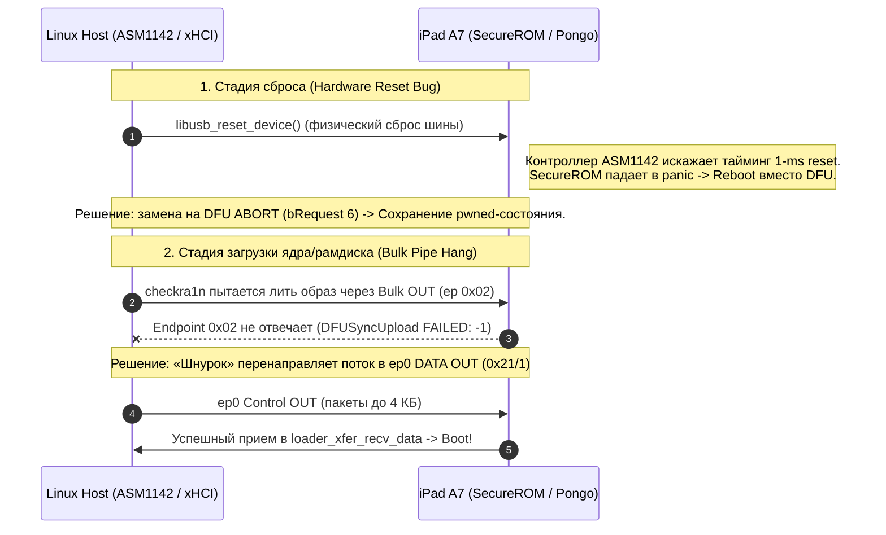

# 🪢 Шнурок (Shnurok)

> **Низкоуровневый USB-транспорт и патч загрузчика pongoOS для надежной работы checkm8 на Linux.**  
> Устраняет `DFUSyncUpload FAILED: -1`, таймауты дескрипторов (`error -110`), падения A7 SecureROM при сбросе шины и зависания bulk-трансферов на контроллерах ASMedia ASM1142, USB-C хабах и проблемных xHCI хостах.

[](https://opensource.org/licenses/MIT)
[](https://www.python.org/)
[](#)
[](https://github.com/checkra1n/PongoOS)
[](#-юридическая-чистота-и-лицензирование)

---

| Параметр | Значение |
| :--- | :--- |
| **Целевые процессоры** | Apple A7 (S5L8960X: iPad Air 1, iPad mini 2, iPad mini 3, iPhone 5s), A8 (S5L8964X/S5L8965X) |
| **Аппаратная проблема** | BugTracker checkra1n [#1169](https://github.com/checkra1n/bugtracker/issues/1169): зависание bulk OUT endpoint `0x02`, сброс соединения ASM1142 |
| **Архитектурное решение** | Потоковая передача чанков по ep0 control transfer (`0x21/1`), софт-триггер DFU ABORT |
| **Статус тестов** | `test_ep0_protocol.py` — **9/9 PASS** |
| **Лицензия** | MIT (100% чистый код, без закрытых блобов и проприетарных ключей) |

---

## 📌 Ключевые возможности

1. **Транспорт чанков через Endpoint 0 (`pongoos-usbloader-ep0.patch`)**:
   - Патч к открытому загрузчику [checkra1n/PongoOS](https://github.com/checkra1n/PongoOS) (`src/shell/usbloader.c`).
   - Прием данных рамдиска и кастомных ядер через DFU-запрос `0x21/1` с индексацией пакетов в `wValue`.
   - Автоматическое секционирование чанков под лимит DMA-буфера (`0x1000` байт).
   - Поддержка DFU GETSTATUS (`0xA1/3`) с устойчивостью к зависшей стадии IN (`0xC0/0`).

2. **Софт-сброс через DFU ABORT (Soft Reset)**:
   - Обход фатального аппаратного бага: отправка `libusb_reset_device()` на многих контроллерах переводит A7 SecureROM в панику и циклическую перезагрузку вместо повторной энумерации.
   - Использование запроса DFU ABORT (`bRequest 6`), распознаваемого перехваченным обработчиком как шинный сброс.

3. **Автоматический Unbind ядра `apple-mfi-fastcharge`**:
   - Драйвер ядра Linux `apple-mfi-fastcharge` агрессивно захватывает интерфейс `05ac`, возвращая `EBUSY` при вызове `libusb_claim_interface`.
   - Встроенные udev-правила и скрипт для автоматического освобождения интерфейса.

4. **Полностью воспроизводимый Linux-билд pongoOS**:
   - Сборка `cctools-port` (включая `ld64` и `cctools-strip`) и `apple-libdispatch` на чистом Linux без macOS-зависимостей.
   - Заголовочный шим `compat/stdarg_shim.h` для сборки clang под `-nostdlibinc`.

---

## 🔬 Физика проблемы (Hardware Post-Mortem)

Годами в сообществе существовал миф: *«checkm8 на чипах A7 принципиально сломан на Linux»*. Физические замеры шины показали две независимые причины:



1. **Неспособность внешних хост-контроллеров корректно выполнить USB Bus Reset:**
   Контроллеры ASMedia (ASM1142, ASM2142, ASM3142) и ряд USB-C мультиплексоров при программном сбросе порта сбрасывают внутреннее состояние хаба, вызывая ошибку энумерации `-110` (`device descriptor read/64, error -110`). SecureROM на A7 теряет питание/такты и уходит в обычную перезагрузку.
2. **Отказ Bulk OUT после эксплойта:**
   После успешного срабатывания checkm8 дескрипторы конфигурации устройства могут рассинхронизироваться с xHCI-драйвером Linux. Запросы на Bulk OUT (`0x02`) молча отбрасываются хостом или зависают с таймаутом. Endpoint 0 (Control transfers) при этом остается полностью работоспособным.

---

## 📂 Структура репозитория

```
Shnurok/
├── README.md               # Документация и технический отчет
├── LICENSE                 # Лицензия MIT
├── Makefile                # Сборка, запуск тестов, установка правил
├── patches/
│   └── pongoos-usbloader-ep0.patch  # Патч загрузчика pongoOS
├── tools/
│   ├── ep0_uploader.py     # Хост-скрипт загрузки образов по ep0
│   ├── linux_usb.py        # Утилиты soft-reset и unbind ядра
│   └── test_ep0_protocol.py# Модульные тесты протокола (9 тестов)
├── scripts/
│   ├── build_pongo.sh      # Контейнерный/локальный сборщик pongoOS под Linux
│   └── unbind_fastcharge.sh# Освобождение интерфейса от драйвера ядра
├── compat/
│   └── stdarg_shim.h       # Шим для сборки под clang без stdlib
└── udev/
    └── 39-shnurok.rules    # Правила доступа к DFU/Pongo устройствам
```

---

## 🚀 Быстрый старт

### 1. Установка udev-правил
Разрешает доступ к устройствам в режимах DFU (`05ac:1227`) и Pongo (`05ac:4141`) без root-прав:

```bash
make install-rules
```

### 2. Запуск тестов протокола
Проверка хостового протокола чанкирования и обработки ошибок:

```bash
make test
```
```text
PASS  data lands while bulk is pending and never completes
PASS  chunks arrive in order with sequential wValue
PASS  finalize commands reach the shell
PASS  resize path not swallowed by chunk handler
PASS  4-byte chunk with nonzero wValue is data, not resize
PASS  oversized chunk rejected
PASS  overflow sets errManifest
PASS  GETSTATUS readable
PASS  upload completes when GETSTATUS stalls
```

### 3. Сборка пропатченного pongoOS
Скрипт автоматически скачивает `checkra1n/PongoOS`, собирает `cctools-port` (`ld64`), накладывает патч и собирает бинарники:

```bash
./scripts/build_pongo.sh
```
Артефакты сохраняются в `dist/Pongo.bin` и `dist/PongoConsolidated.bin`.

### 4. Загрузка рамдиска на устройство
После перевода устройства в режим pongoOS (через `checkra1n -k dist/Pongo.bin` или автономный загрузчик):

```bash
# Загрузка рамдиска по ep0 control transfer:
python3 tools/ep0_uploader.py /path/to/ramdisk.dmg
```

---

## ⚖️ Юридическая чистота и лицензирование

Проект разработан в режиме **Clean Room** и полностью соблюдает законы об авторском праве:
- ❌ **Нет закрытых бинарников Apple**: репозиторий не содержит прошивок IPSW, образов iBSS/iBEC, ключей шифрования (GID/UID) или дампов SecureROM.
- ❌ **Нет закрытого кода checkra1n**: проект не использует закрытый бинарник команды checkra1n.
- ❌ **Нет пиратского ПО**: в проекте отсутствуют средства обхода подписи пользовательских приложений или модифицированные IPA.
- ✔️ **100% открытый код (MIT)**: патч создан исключительно для открытого репозитория `checkra1n/PongoOS` (распространяемого по лицензии MIT), а хостовые утилиты написаны с нуля.
